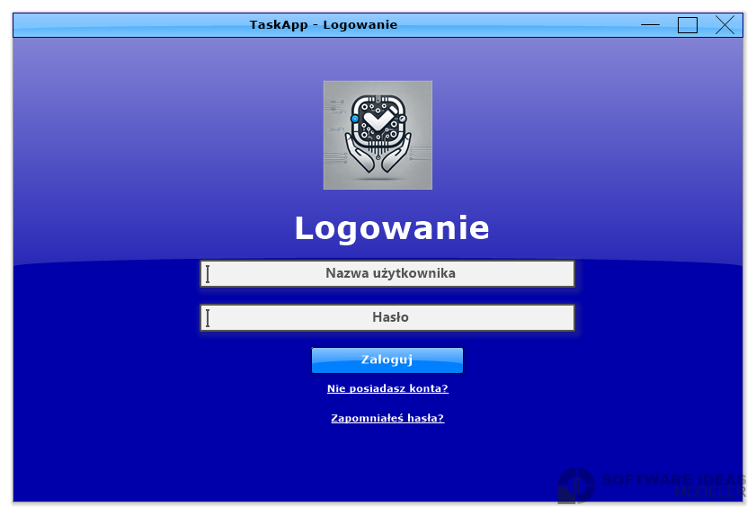
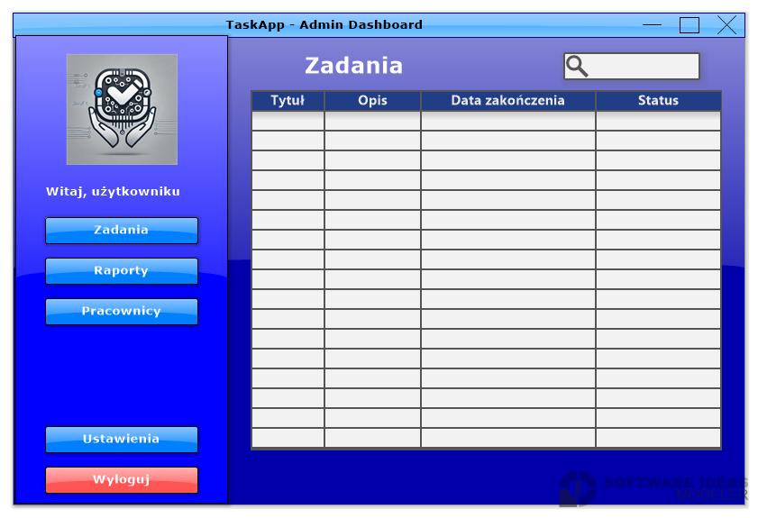
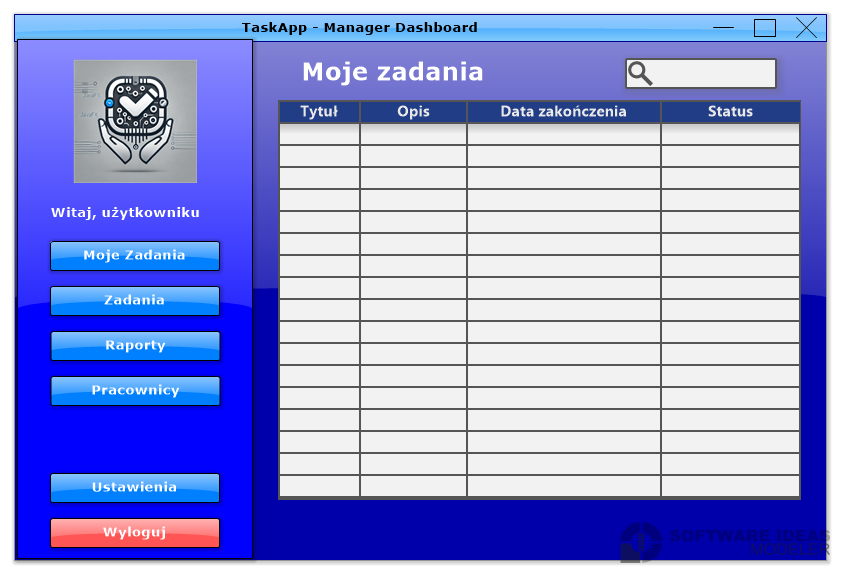
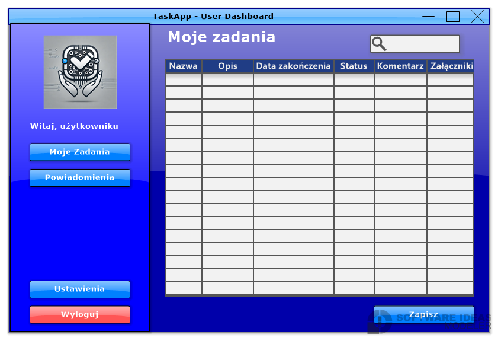
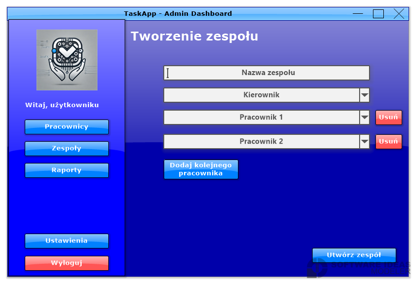
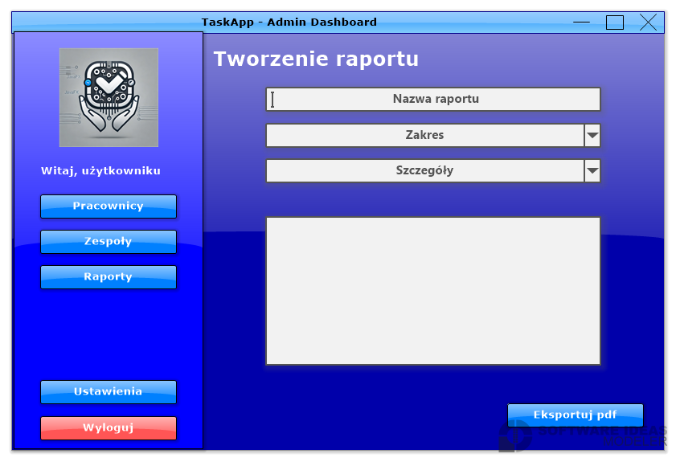

# TaskApp

> 📋 **Four roles, four applications** — a JavaFX task manager where what you see is decided by who you are, not by a hidden menu item

**TaskApp** manages projects, teams and tasks for an IT company. An administrator, a manager, a team leader and an employee each sign into the same application and get a different interface: separate FXML trees, separate controllers, separate dashboards. A role does not simply hide buttons — it loads a different view.

Underneath sits a MariaDB schema reached through hand-written DAOs, with migration and seeder scripts in the repository, an activity log for every task, and PDF reports generated with iText.


---

## 🎯 Key Features

- **A separate interface per role** — `fxml/admin`, `fxml/manager`, `fxml/teamleader` and `fxml/user` are four view trees with their own controllers. Sign-in decides which one loads.
- **Tasks with a history** — every change is written to a task activity log, so a task carries its own audit trail rather than just a current status.
- **Projects, teams and members as real relations** — `ProjectDAO`, `TeamDAO`, `TeamMemberDAO` and `TaskAssignmentDAO` each own their queries, which is why the schema is visible in the code rather than buried in one god-class.
- **PDF reports** — iText and xmlworker turn the reporting views into documents the manager can send on.
- **Migration and seeder scripts included** — `SQL/migration.sql` builds the schema, `SQL/seeder.sql` fills it, so a working instance is two commands away.
- **DAOs covered by tests** — JUnit 5 tests for every DAO plus the database manager, run against H2 so they need no live server.
- **The design is documented** — ERDs in `SQL/`, UML in `UML/`, generated Javadoc in `JAVA_DOCS/`, and twenty-three interface screenshots in `GUI/IMG`.

---

## 🖼️ Screenshots

| Sign-in                                      | Administrator dashboard                        |
| -------------------------------------------- | ---------------------------------------------- |
|       |  |

| Manager dashboard                            | Employee dashboard                             |
| -------------------------------------------- | ---------------------------------------------- |
|  |  |

| Creating a team                              | Reports                                        |
| -------------------------------------------- | ---------------------------------------------- |
|  |  |

---

## 👥 The Four Roles

| Role            | What the application becomes                                              |
| --------------- | ------------------------------------------------------------------------- |
| **Administrator** | Users, teams, projects, settings, logs and reports across the company.    |
| **Manager**       | Their projects and the teams working on them; task assignment and progress. |
| **Team leader**   | One team: its members, its tasks, its workload.                           |
| **Employee**      | Their own tasks, their status and the history behind them.                |

---

## 🛠️ Technology Stack

| Technology            | Version | Role                                                    |
| --------------------- | ------- | ------------------------------------------------------- |
| **Java**              | 17+     | Application language.                                   |
| **JavaFX**            | 21      | Controls and FXML views.                                |
| **FormsFX**           | 11.6    | Form construction.                                      |
| **MariaDB JDBC**      | 3.x     | Database connection.                                    |
| **H2**                | —       | In-memory database for the DAO tests.                   |
| **iText + xmlworker** | 5.5     | PDF report generation.                                  |
| **JUnit 5**           | 5.10    | DAO and model tests.                                    |
| **Maven**             | —       | Build and dependency management.                        |

---

## 🚀 Getting Started

### Prerequisites

- JDK 17 or newer
- Maven 3.8 or newer
- MariaDB (or MySQL)

### 1. Clone the repository

```bash
git clone https://github.com/dawidolko/TaskApp-JavaFX.git
cd TaskApp-JavaFX
```

### 2. Prepare the database

```bash
mysql -u root -p < SQL/migration.sql
mysql -u root -p < SQL/seeder.sql
```

### 3. Build and run

```bash
cd CODE/App
mvn clean javafx:run
```

### 4. Tests

```bash
mvn test
```

Detailed installation notes are in [`INSTALL/`](INSTALL).

---

## 📁 Project Structure

```
TaskApp-JavaFX/
├── CODE/App/
│   ├── pom.xml
│   └── src/
│       ├── main/
│       │   ├── java/pl/rozowi/app/
│       │   │   ├── MainApplication.java   # entry point and the splash screen
│       │   │   ├── controllers/           # one per view, grouped by role
│       │   │   ├── dao/                   # User, Task, Team, Project, Role, Settings…
│       │   │   ├── models/                # the domain objects
│       │   │   ├── database/              # connection and manager
│       │   │   ├── services/              # reports and shared logic
│       │   │   └── util/
│       │   └── resources/
│       │       ├── fxml/                  # login, register, admin/, manager/,
│       │       │                          # teamleader/, user/
│       │       ├── css/  images/
│       │       └── db/                    # migration and seeder resources
│       └── test/java/pl/rozowi/app/       # JUnit 5 tests for every DAO
├── SQL/                # migration.sql, seeder.sql, ERD (drawio + png)
├── UML/                # design diagrams
├── GUI/IMG/            # 23 interface screenshots
├── JAVA_DOCS/          # generated Javadoc
├── DOC/  PDF/  DAILY/  # documentation and the work log
└── INSTALL/            # installation notes
```

---

## 📄 License

MIT © [Dawid Olko](https://dawidolko.pl)
